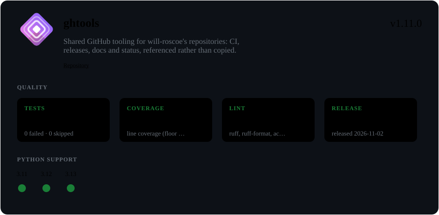

Shared GitHub tooling for will-roscoe's repositories. CI, Conventional-Commit releases, docs
and the status card are defined once here. Each repo *references* them, so a
change here reaches every repo on its next run without a commit to that repo.

Agents adopting, configuring or changing ghtools: read [AGENTS.md](AGENTS.md).

## Using it in a repo

```bash
pipx install git+https://github.com/will-roscoe/.ghtools@v1
cd path/to/repo
ghtools init --dry-run   # see what it detects and would change
ghtools init             # writes .github/ghtools.toml + .github/workflows/ghtools.yml
git diff                 # review, then commit and push
ghtools doctor           # check the GitHub side (secrets, rulesets, Pages)
```

`init` archives the old `.github/` to `.github/archive/pre-ghtools-<date>/` before removing
the workflows ghtools replaces. `ghtools deinit` undoes it.

## Configuration

`.github/ghtools.toml` holds only what differs between repos. Every key and its default is in
`src/ghtools/config.py` (`SCHEMA`); `ghtools config check` validates the file, and
`ghtools init` writes each detected value with a comment naming the evidence.

## Runner resolution

`ghtools ci matrix` pairs each `ci.python` with `ci.runners[0]` (and the newest python with the
other runners), then checks every leg against the Python builds `actions/setup-python` can
download. A runner label is parsed to OS, version and architecture (`ubuntu-latest` is looked up
in `src/ghtools/data/runners.json`, the one hand-kept fact, since GitHub moves the `-latest`
aliases). If `src/ghtools/data/python_builds.json` has a build for that OS version, the label is
kept. Otherwise the leg moves to the newest OS version of the same OS and architecture that has
one, under an explicit label (`3.9` on `ubuntu-latest` runs on `ubuntu-24.04`; on
`ubuntu-24.04-arm` it stays arm). With no build on any version the leg is dropped with a
`::warning::skipped: no python X.Y build for os/arch`. `ghtools config check` prints the same
warnings.

`rules` in `runners.json` cover what the manifest cannot say. A rule applies to legs matching
`match` (`python`, `os`, `arch`; versions compare numerically, `3.10 > 3.9`) and requires the
runner's OS version to satisfy `require.version`:

```json
{"match": {"python": ">=3.15", "os": "darwin"}, "require": {"version": "<=15"}}
```

Refresh the build snapshot with `python scripts/refresh_python_manifest.py` (fetches
`actions/python-versions`; the matrix itself never touches the network).

## Commands

| Command | Does |
|---|---|
| `ghtools init` / `deinit` | set up / undo ghtools in the repo you're in |
| `ghtools doctor` | check settings, stub, secrets, rulesets, Pages |
| `ghtools init --community` | also add issue forms, a PR template, CONTRIBUTING and SECURITY where missing |
| `ghtools sync OWNER/NAME… \| --all [--dry-run]` | open a pull request updating each repo's stub when the stub contract changes |
| `ghtools version next --explain` | what merging now would release, and why |
| `ghtools resync` | after a push: fetch tags, fast-forward, reinstall an editable install |
| `ghtools hooks install` | warn-only pre-push hook running the configured gates |
| `ghtools status url` / `render` | the status card's README URL / a local preview of the status branch |
| `ghtools stub [--write]` | the workflow stub for the current settings, keeping its pinned ref |
| `ghtools readme sync --check` / `--write` | check or regenerate README blocks (`[[readme.block]]`) from their single source |
| `ghtools codecov --check` / `--write` | check or write `.github/codecov.yml` from `[ci.coverage]` (project may drop `threshold` points, default 2; patch is informational; `[[ci.coverage.component]]` rows become Codecov components) |

## Codecov uploads

Each upload counts against the Codecov plan's monthly allowance, so a run uploads coverage and test
results from one test leg (the first, plus one per subproject), and only when code under
`ci.paths` changed. `ci.coverage.uploads-per-day` (default 1, `0` = no limit) caps the runs that
upload per UTC day, counted separately for each subproject. The count is kept in Actions cache
entries, which are per branch: a pull request sees what the default branch uploaded today, but
not the other way round.

```toml
[ci.coverage]
uploads-per-day = 3
```

## Skipping CI on pull requests

`ci.skip-pr-heads` (default empty) lists head branches whose pull requests skip CI (tests, gates,
docker and lint legs), for a release branch whose commits were already tested as pull requests
into it. A repo that merges into `next` locally can get that record from `ghtools ci test --record` with `ci.accept-local-tested`. Other pull requests and all pushes are unaffected.

```toml
[ci]
skip-pr-heads = ["next"]
```

## Building docs only when relevant

`docs.paths` (default empty = docs build on every run) lists path globs, like `ci.paths`. When
set, the docs job runs only if the change touches one of them or ghtools's own settings and stub: a
pull request is compared with its base, a push with its old head. A skipped job counts as passing
for branch protection, and `docs-deploy` is skipped with it, so the published site stays as it was.
Pushes to the default branch follow the same rule, so docs are rebuilt and deployed on the push
that merges a docs-relevant change (a failed deploy is retried by the next such push or a manual
run, which has no base and always builds). Include the sources the docs import, for autodoc.

```toml
[docs]
paths = ["doc/**", "src/**.py", "pyproject.toml"]
```

## Publishing the docs of a release

The docs job builds the pushed commit, before the release jobs commit the new version and
changelog (`chore(release): ... [skip ci]`), so the site deployed on a releasing push shows the
previous release. `docs.after-release` (default false; needs `docs.enabled` and `docs.pages`) adds
two jobs: `docs-release` rebuilds the docs from that release commit, and `docs-release-deploy`
publishes them after `docs-deploy`, in the same `pages` concurrency group. They build only the
release commit this run pushed (root, components, or both), and only while the branch is still at
it. A dry run, a run that released nothing, a failed release job or a branch that moved builds
nothing and says why in a notice. With `docs.paths` set, the docs are rebuilt only if the push or
the release commit touched those paths.

```toml
[docs]
enabled = true
pages = true
after-release = true
```

## Reusing pull request test results

`ci.reuse-pr-results` (default false) lets the push that merges a pull request skip CI when the
pushed commit's *tree* already passed. A same-repo pull request run that passes records its merged
tree and its status legs as `refs/ghtools/tested/<tree>` (a ref, no branch or tag). The push to
the default branch looks its own tree up there: found, passing, and covering every leg the push
would run, then tests, lint and docker are skipped, the recorded legs feed the status card and
badges, and the record is deleted. A different tree (the base moved after the pull request ran, a
release commit on the default branch) runs everything as usual, as does a CI-forcing directive such as `[ci]`, a fork
pull request (read-only token) or any doubt. Codecov is not uploaded for a reused push. Needs
nothing beyond the stub's existing `contents: write`.

```toml
[ci]
reuse-pr-results = true
```

## Test selection and tested records

`[[ci.select]]` rules leave out slow pytest markers when a change cannot affect them. A rule
names a `marker` and `changed` globs; when no changed file matches, `ghtools ci test` ends with
`-m "not <marker>"`. The config job prints the selection with `ghtools ci select`, diffing a pull
request against its base and a push against the before-SHA (else the first parent). An unknown or
unresolvable base, an event listed in `ci.select-full-on`, a run forced by a directive, a push that
would release the root or a component, or a repo with no rules deselects nothing, so a repo without rules sees exactly the jobs and commands it did before. Rules need
`ci.test` to be a single pytest command: `&&`, `||`, `;` or `|` in it is a config error. The
`-m` is appended last, so it overrides an `addopts = -m ...` in the pytest config; with a deselection,
pytest exit 5 (nothing collected) counts as a pass. A released component's pytest row is selected
too; only a `test-command` row is exempt. A repo that deselects markers itself (a conftest hook, or `addopts = -m`) must stop doing so for markers that have a rule, or the rule's tests are silently skipped while records claim a full run.

The same selection goes to `ci skip-pr`, `ci reuse` and `ci record-tested`, so a record says what
it ran. A repo with rules reuses only a record that made a claim and left out nothing the run
wants: a full run, or one that deselected no more than this run does.

`ghtools ci test --record` runs the lint gates and the tests locally (with the selection computed against the merge-base with `origin/<branch>`, or `--base REV`; a base equal to HEAD, as on the default branch itself, counts as unknown and runs everything) and records the clean tree as tested; `ci.accept-local-tested` lets reuse accept
such a record (never on a push that releases, which needs one clean CI run), but only if its gates passed (a failing gate records nothing). It tests every subproject, so `--subproject` and `--deselect` are refused with it,
and it never replaces a record made by CI. Gitignored files are not checked.

```toml
[ci]
select-full-on = ["push"]      # every push deselects nothing (reuse can still skip it)
accept-local-tested = true     # trust a local `ghtools ci test --record`

[[ci.select]]
marker = "tui"
changed = ["src/sph/phantom_live/**"]
```

## Released components

An in-tree `[[subprojects]]` row with `release = true` versions and releases on its own, alongside
or instead of the repo's `v{x}` releases (`release.root = false` stops those). All keys are
opt-in; a repo that sets none behaves as before.

```toml
[[subprojects]]
name = "cdn"
path = "src/cdn"
release = true
needs = ["common"]                       # its commits also count when `common` changes
version-file = "src/cdn/pyproject.toml"  # default <path>/pyproject.toml (.toml or JSON manifest)
changelog = "src/cdn/CHANGELOG.md"       # default <path>/CHANGELOG.md
tag = "{name}/{version}"                 # default; tags look like cdn/0.4.1
apidoc = ["src/cdn/cdn"]                 # sphinx-apidoc into <docs.dir>/api/cdn/
test-command = ""                        # set to run a command instead of pytest

[status]
layout = "components"                    # a Repository block plus one block per component
```

The `release-components` job commits every component's version and changelog in one commit and
pushes it with all the new tags in one atomic push. A component whose version file is ahead of its
tags is not released until you tag that version. A component with no tag at all releases on the next
push unless its version file is ahead, so backfill lightweight tags before setting `release = true`.
A due component release runs CI over that component, plus whatever the push touched, first. `tag` must contain `{name}`. `ghtools release components decide` prints
each decision and its reason. Details and pitfalls are in [AGENTS.md](AGENTS.md).

## Commit directives

Off by default. With `[directives] enabled = true`, tokens in the commits pushed to the default
branch act on that pipeline run, written `[name]` or `/name`:

| Token | Effect |
|---|---|
| `[ci]`, `[test]`, `[test-full]`, `[lint]`, `[coverage]` (optionally `:py`) | run CI even if no watched path changed |
| any of those with another language, e.g. `[lint:f2]` | a warning; nothing to run |
| `[docs]` | a notice: docs already build on every run (with `docs.paths` set it does not force a build) |
| a name listed in `dispatch` | start that repository workflow (`gh workflow run`) once the pipeline succeeds |

```toml
[directives]
enabled = true
dispatch = { update-todo = "update-todo.yml" }
```

A directive quoted in backticks (`` `[ci]` ``) is prose and does nothing. Release directives
(`+:major`, `+:minor`, …, alone on a line) are separate and always on. `ghtools stub --write`
adds the stub's dispatch job after you add `dispatch` entries.

## Updating the stub everywhere

The stub changes rarely (a new trigger, secret or publish job). When it does, `STUB_VERSION` goes up
and every stub is out of date. Run `ghtools sync --all --dry-run` to see which repos need it, then
`ghtools sync --all` to open one pull request per repo. Each is re-rendered from that repo's own
settings and keeps its pinned ref; repos with an open update PR are skipped.

## Versions

Repos pin `pipeline.yml@v1`, a tag moved to each new 1.x release. Breaking changes start `v2`.
Pin a full commit SHA instead of `v1` to opt out of automatic updates.

## Licence

MIT. Files ghtools writes into other repos are also MIT-0, so they carry no notice requirement.
